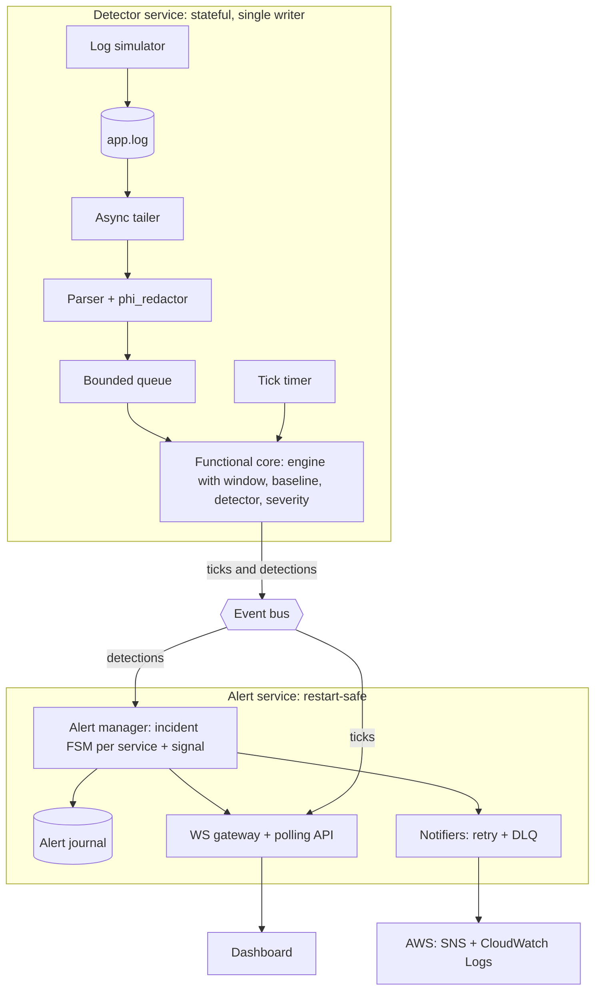

# Real-Time Log Anomaly Detector: Architecture and Implementation Plan (v2)

HackForge x Acentra Health hiring hackathon, Problem 1 (Python). Time budget: 4.5 hours.
This file is the single source of truth for architecture decisions, contracts, data, build order, and demo. It replaces `IMPLEMENTATION_PLAN.md`.

## What changed from v1

| Change | Why |
|---|---|
| Added `VOLUME_DROP` signal | Catches the log source dying silently, which the error-rate gate cannot see |
| Added wire protocol (section 5.5) | Frontend and gateway developers can build in parallel |
| Added module interfaces and a new `core/engine.py` (section 5.4) | Removes guessing between parallel developers; single entry point for shell and replay tests |
| Added config validation (section 5.3) | Fail fast on bad config, degrade gracefully on unavailable dependencies |
| Added simulator HTTP control (section 7.3) | Live demo control, including volume, without file hacks |
| **Baseline freeze is now detector-local** | v1 tied it to incident state that lives in the other service, which breaks at the Stage 2 seam |
| **`Detection` now carries a status (`TRIGGERED`/`HOLD`/`CLEAR`)** | Hysteresis needs the "in-between" reading, which "detection or None" cannot express |
| Split raw `WindowMetric` from enriched `MetricTick` | The window does not know the baseline |
| Added datasets section (section 7) | Synthetic generator is primary; optional real-data validation on NASA-HTTP |

---

## 1. Positioning (what we tell the judges)

We build a **modular monolith with a strict event-bus seam**, delivered in two stages:

- **Stage 1 (guaranteed by about 2:00):** one FastAPI process, in-memory event bus, functional-core detector. Working end to end.
- **Stage 2 (only if the gate at 3:00 passes):** the same code split into two containers (detector, alerts) over Redis Streams by swapping one adapter.

Pitch language must match what actually shipped:

- If Stage 2 shipped: "two services, split along the state and scaling seam, connected by Redis Streams."
- If not: "single process today; the boundary is enforced in code and by tests, and only the bus adapter changes to go distributed." Do not claim microservices we did not run. Experts will probe, and an honest, well-reasoned answer scores higher than an overclaim.

| Keyword | Our answer |
|---|---|
| Monolith | Modular monolith by default; boundaries verified by a test that `core/` imports no adapters |
| Microservices | One deliberate seam (detector vs alerts) documented in an ADR; Stage 2 runs it as two containers |
| Cloud native | 12-factor config, health probes, graceful shutdown, JSON logs, /metrics, IaC, IAM roles, LocalStack parity |
| CI/CD | GitHub Actions from minute 20: lint, unit tests, deterministic replay tests, Docker build, Trivy scan |

---

## 2. Requirements traceability

| Requirement | Module | Proof in demo |
|---|---|---|
| Monitor a continuously growing log file | `detector/tailer.py` | Live tail plus rotation and truncation tests |
| Rolling error rates, sliding window | `core/window.py` | Chart of 60s error rate |
| Baseline for normal behavior | `core/baseline.py` | Baseline band on the chart |
| Detect deviations | `core/detector.py` | Injected spike opens an alert |
| Severity levels | `core/severity.py` | LOW to HIGH escalation with evidence |
| Real-time frontend (WebSocket or polling) | `alerts/gateway.py` | Kill the socket; polling fallback continues |
| Display alerts as generated | `dashboard/` | Alert appears within seconds of injection |
| Push to CloudWatch Logs or SNS | `alerts/notifier.py` | SNS message and CloudWatch entry (LocalStack or real) |
| Beyond the brief: silent-source detection | `core/detector.py` (`VOLUME_DROP`) | Set simulator volume to 0; HIGH alert in about 20s |

---

## 3. Architecture



### 3.1 Design principles

1. **Functional core, imperative shell.** Everything in `core/` is pure: no files, sockets, `boto3`, or `time.time()`. Time is an argument. The core is deterministic, unit-testable, and replayable in CI in milliseconds.
2. **Ports and adapters.** The core talks to the world only through `EventBus`. Tailer, gateway, notifiers, and journal are adapters.
3. **One seam, deliberately placed.** The detector is stateful (windows, baseline) and driven by log volume. The alert service is driven by clients and delivery. They fail and scale differently, so this is the one justified service boundary.
4. **The tick is timer-driven, not event-driven.** `engine.tick(now)` runs on a timer even when no log lines arrive. This is what lets `VOLUME_DROP` fire on total silence.
5. **Never block the event loop.** Every `boto3` call goes through `asyncio.to_thread`.
6. **Privacy before aggregation.** PHI redaction runs in the parser, before any line reaches the queue, journal, WebSocket client, or AWS.
7. **Fail fast on config, degrade on dependencies.** Invalid config halts startup. An unreachable dependency (AWS, Redis) degrades to a fallback with a visible flag, never a crash.
8. **Fail visibly.** Bounded queues with explicit drop policies, a DLQ for undeliverable notifications, counters on `/metrics`.

### 3.2 Notes on state

- The alert service is **restart-safe** (incident state is rebuilt from the journal), not horizontally scalable. Scale-out is the target-architecture story, not something we claim to have built.
- **The baseline freeze must not depend on incident state.** Incident state lives in the alert service; in Stage 2 that is across the seam. The detector therefore freezes its own baseline based on its own readings (section 6.2). There is no feedback loop from alerts back to the detector.

---

## 4. Repository layout

```
.
├── core/                     # PURE logic, no I/O, injected clock
│   ├── engine.py             # orchestrates per-service window -> baseline -> detector
│   ├── window.py             # 1s bucket ring buffer, rolling rates, short volume window
│   ├── baseline.py           # EWMA + MAD, expected volume, warm-up, freeze
│   ├── detector.py           # error_rate signal, sustained ceiling, VOLUME_DROP signal
│   ├── severity.py           # explainable severity rules
│   └── incident.py           # IncidentFSM: NORMAL -> OPEN -> ESCALATED -> RESOLVED
├── detector/                 # adapters for the detector service
│   ├── tailer.py             # async tail: inode/offset, partial lines, rotation
│   ├── parser.py             # parse + phi_redactor
│   ├── simulator.py          # LineGenerator (pure) + async writer + HTTP control
│   └── main.py               # tailer -> parser -> queue -> engine; tick timer; publishes to bus
├── alerts/                   # adapters for the alert service
│   ├── manager.py            # subscribes to detections; registry of IncidentFSMs
│   ├── journal.py            # append-only JSONL, replay on startup
│   ├── gateway.py            # FastAPI: /ws, /api/alerts, /api/ticks, health, metrics
│   ├── notifier.py           # BaseNotifier + Console, CloudWatch, SNS implementations
│   └── main.py
├── shared/
│   ├── schemas.py            # Pydantic models
│   ├── bus.py                # EventBus interface + InMemoryBus (+ RedisStreamsBus in Stage 2)
│   └── config.py             # env-only settings, validation, ConfigError
├── tools/
│   ├── make_fixtures.py      # deterministic fixture generation from the simulator
│   └── replay_eval.py        # OPTIONAL: offline validation on real data (section 7.5)
├── dashboard/                # single static page (Chart.js), served by gateway
├── deploy/
│   ├── docker-compose.yml    # Stage 1: app + localstack. Stage 2: detector, alerts, redis, localstack
│   ├── Dockerfile            # multi-stage, non-root
│   └── terraform/            # SNS topic, log group, least-privilege IAM (optional)
├── tests/
│   ├── fixtures/             # generated logs (section 7.4)
│   ├── test_window.py  test_baseline.py  test_detector.py  test_incident.py
│   ├── test_parser_phi.py  test_tailer.py  test_bus.py  test_config.py
│   ├── test_boundaries.py    # core/ imports no adapters or I/O libraries
│   └── test_replay.py        # deterministic end-to-end replay on fixtures
├── docs/adr/0001-service-seam.md
├── .github/workflows/ci.yml
└── README.md
```

---

## 5. Contracts (lock these in the first 25 minutes)

### 5.1 Schemas (`shared/schemas.py`)

Internally, time is **float epoch seconds**. It is converted to ISO 8601 UTC only at the wire edge (gateway, journal, AWS payloads).

```python
class LogEvent(BaseModel):
    ts: float; level: str; service: str
    message: str                     # already redacted
    latency_ms: float | None = None

class WindowMetric(BaseModel):       # RAW, produced by SlidingWindow
    ts: float; service: str
    total: int; errors: int          # over WINDOW_SECONDS
    error_rate: float | None         # None when total == 0
    volume_rate: float               # lines/sec over VOLUME_WINDOW_SECONDS

class MetricTick(BaseModel):         # ENRICHED, produced by Engine, sent to clients
    metric: WindowMetric
    baseline: float | None; sigma: float | None
    z_score: float | None            # None while warming up or when error_rate is None
    expected_volume: float | None    # lines/sec
    warming_up: bool

class Detection(BaseModel):          # one per service per signal per evaluation
    ts: float; service: str
    signal: Literal["error_rate", "volume_drop"]
    status: Literal["TRIGGERED", "HOLD", "CLEAR"]
    candidate_severity: Literal["LOW","MEDIUM","HIGH","CRITICAL"] | None
    score: float | None              # z for error_rate, volume ratio for volume_drop
    evidence: dict

class Alert(BaseModel):
    id: str; fingerprint: str; service: str; signal: str
    state: Literal["OPEN","ESCALATED","RESOLVED"]
    severity: Literal["LOW","MEDIUM","HIGH","CRITICAL"]
    opened_at: float; updated_at: float
    evidence: dict; history: list[dict]
```

### 5.2 Event bus (`shared/bus.py`)

```python
class EventBus(Protocol):
    async def publish(self, topic: str, event: BaseModel) -> None: ...
    def subscribe(self, topic: str, group: str) -> AsyncIterator[BaseModel]: ...
```

- Topics: `ticks`, `detections`, `alerts`.
- `InMemoryBus`: one bounded `asyncio.Queue` per subscriber.
- Drop policy: `ticks` is **drop-oldest** (a slow chart client must never stall detection). `detections` and `alerts` are **never dropped**; the publisher awaits on a full queue and a stall counter records it.
- Stage 2 `RedisStreamsBus`: consumer groups, ack after the consumer has journaled the transition.

### 5.3 Config (`shared/config.py`)

Environment variables only, every one with a default. Use `pydantic-settings` (a separate package in Pydantic v2) or plain dataclass plus validators.

| Variable | Default | Meaning |
|---|---|---|
| `WINDOW_SECONDS` | 60 | Main window for error rate |
| `EVAL_INTERVAL_SECONDS` | 2 | Tick cadence |
| `EWMA_ALPHA` | 0.05 | Baseline smoothing |
| `SIGMA_FLOOR` | 0.01 | Minimum spread, avoids infinite z on a quiet baseline |
| `WARMUP_EVALS` | 30 | Evaluations before detection is allowed |
| `Z_OPEN` / `Z_CLEAR` | 3.0 / 1.5 | Hysteresis thresholds |
| `MIN_DELTA` | 0.02 | Minimum absolute rate change over baseline |
| `MIN_VOLUME` | 20 | Minimum lines in the window to evaluate error rate |
| `RATE_CEILING` / `CEILING_EVALS` | 0.20 / 5 | Sustained absolute ceiling |
| `CLEAR_EVALS` | 3 | Consecutive CLEAR readings to resolve |
| `COOLDOWN_SECONDS` | 60 | Reopen window after resolve |
| `BASELINE_COOLDOWN_SECONDS` | 30 | Extra freeze after readings return to normal |
| `VOLUME_WINDOW_SECONDS` | 15 | Short window for volume rate |
| `VOLUME_DROP_RATIO` / `VOLUME_DROP_CLEAR_RATIO` | 0.2 / 0.5 | Trigger below 20% of expected; clear above 50% |
| `VOLUME_DROP_EVALS` | 5 | Consecutive low evaluations to trigger |
| `VOLUME_MIN_EXPECTED_RPS` | 0.5 | Do not evaluate volume for naturally quiet services |
| `HEARTBEAT_SECONDS` | 15 | WebSocket heartbeat |
| `NOTIFIERS` | `console` | Comma list: `console,cloudwatch,sns` |
| `SNS_TOPIC_ARN`, `CW_LOG_GROUP`, `AWS_ENDPOINT_URL` | empty | AWS settings; endpoint URL selects LocalStack |
| `BUS_BACKEND` / `REDIS_URL` | `memory` / empty | Bus selection |
| `LOG_PATH` | `./data/app.log` | Log file to tail |
| `SIM_CONTROL` / `SIM_BIND` / `SIM_PORT` | `0` / `127.0.0.1` / `8001` | Simulator HTTP control (demo only) |

**Validation (fail fast, raise `ConfigError`, halt):**
- `WINDOW_SECONDS > 0`, `EVAL_INTERVAL_SECONDS > 0`, and `EVAL_INTERVAL_SECONDS <= WINDOW_SECONDS`
- `0 < EWMA_ALPHA < 1`
- `Z_OPEN > Z_CLEAR > 0`
- `MIN_VOLUME > 0`, `MIN_DELTA >= 0`, `CLEAR_EVALS >= 1`
- `0 < RATE_CEILING <= 1`
- `0 < VOLUME_DROP_RATIO < VOLUME_DROP_CLEAR_RATIO <= 1`, `VOLUME_DROP_EVALS >= 1`
- `NOTIFIERS` contains only known names; `sns` requires a non-empty `SNS_TOPIC_ARN`; `cloudwatch` requires `CW_LOG_GROUP`
- `BUS_BACKEND` is `memory` or `redis`; `redis` requires `REDIS_URL`
- `ConfigError` messages name the variable, never print secret values

**Degrade, do not crash:** if AWS is unreachable at startup (cheap probe with a 3s timeout), log a warning, fall back to the console notifier, set `notifier_degraded=1` on `/metrics`, and report it in `/readyz` details. Runtime failures after startup are handled by retry and DLQ, not by fallback.

### 5.4 Module interfaces (`core/` and `alerts/`)

```python
# core/window.py   (one instance per service)
class SlidingWindow:
    def ingest(self, event: LogEvent) -> None: ...
    def snapshot(self, now: float) -> WindowMetric: ...   # expires old buckets using `now`

# core/baseline.py   (one instance per service)
class Baseline:
    def update(self, metric: WindowMetric) -> None: ...   # no-op while frozen
    def freeze(self) -> None: ...
    def unfreeze(self) -> None: ...
    @property
    def p0(self) -> float: ...                # baseline error rate (EWMA)
    @property
    def sigma(self) -> float: ...             # MAD-based spread, floored
    @property
    def expected_volume(self) -> float: ...   # baseline lines/sec (EWMA)
    @property
    def is_ready(self) -> bool: ...           # warm-up complete
    @property
    def frozen(self) -> bool: ...

# core/detector.py   (one instance per service; holds consecutive-count state)
class Detector:
    def evaluate(self, metric: WindowMetric, baseline: Baseline, now: float) -> list[Detection]: ...
    # returns one Detection per signal ("error_rate", "volume_drop") every evaluation

# core/engine.py   (single entry point for the detector shell and replay tests)
class Engine:
    def ingest(self, event: LogEvent) -> None: ...        # routes to per-service window
    def tick(self, now: float) -> TickResult: ...         # TickResult(ticks: list[MetricTick], detections: list[Detection])

# core/incident.py   (one instance per (service, signal))
class IncidentFSM:
    def process(self, reading: Detection, now: float) -> Alert | None: ...   # Alert only on a transition or update worth publishing
    @property
    def state(self) -> IncidentState: ...

# alerts/manager.py
class IncidentRegistry:
    def process(self, reading: Detection, now: float) -> Alert | None: ...   # creates/looks up FSM by fingerprint

# alerts/notifier.py
class BaseNotifier(ABC):
    name: str
    min_severity: Severity
    async def enqueue(self, alert: Alert) -> None: ...
    async def send(self, alert: Alert) -> None: ...       # abstract; boto3 calls via asyncio.to_thread
    async def run(self) -> None: ...                      # worker loop: retry, backoff, DLQ
    async def drain(self) -> None: ...                    # flush on shutdown, bounded wait
```

Rules:
- The engine creates `SlidingWindow`, `Baseline`, and `Detector` for a service the first time it sees it.
- `Engine.tick` must be safe to call with zero ingested events.
- The window never calls the wall clock; every method that needs time takes `now`.

### 5.5 WebSocket wire protocol (`/ws`)

Every message has `v` (protocol version, currently 1) and `type`. All except `heartbeat` carry `seq`, a monotonically increasing integer per gateway process. After a snapshot, the client ignores any tick or alert with `seq <=` the snapshot's `seq`.

```json
// snapshot (sent on connect)
{ "v": 1, "type": "snapshot", "seq": 1042,
  "ticks": { "auth-service": [ /* last 60 tick objects */ ] },
  "alerts": [ /* open alert objects (OPEN or ESCALATED) */ ] }

// tick (every eval interval, per service)
{ "v": 1, "type": "tick", "seq": 1043, "ts": "2026-09-28T10:15:02Z",
  "service": "auth-service",
  "error_rate": 0.023, "baseline": 0.02, "sigma": 0.005, "z_score": 0.5,
  "total": 48, "errors": 1,
  "volume_rate": 24.0, "expected_volume": 23.5,
  "warming_up": false }

// alert (on every state transition or severity/evidence update)
{ "v": 1, "type": "alert", "seq": 1044,
  "id": "uuid", "fingerprint": "hash",
  "service": "auth-service", "signal": "error_rate",
  "state": "OPEN", "severity": "MEDIUM",
  "opened_at": "2026-09-28T10:15:06Z", "updated_at": "2026-09-28T10:15:12Z",
  "evidence": { "observed": 0.25, "baseline": 0.02, "z_score": 5.2, "duration_s": 6,
                "top_messages": [ { "message": "Connection refused", "count": 12 } ] },
  "history": [ { "ts": "2026-09-28T10:15:06Z", "from": "NORMAL", "to": "OPEN", "severity": "MEDIUM" } ] }

// heartbeat (every HEARTBEAT_SECONDS, default 15)
{ "v": 1, "type": "heartbeat", "ts": "2026-09-28T10:15:30Z" }
```

Field rules:
- `error_rate` is `null` when `total` is 0; `z_score` is `null` while `warming_up` is true.
- `signal` is `error_rate` or `volume_drop`. For `volume_drop`, `evidence` holds `observed_rps`, `expected_rps`, `ratio`, and `source_last_growth_s` (seconds since the log file last grew, attached by the shell so operators can tell a silent source from a stalled tailer).
- `top_messages` contains redacted text only.
- There is no singular `incident` field. Multiple services and signals can be open at once, so `alerts` is always a list.
- The client marks the connection stale after two missed heartbeats and switches to polling.
- REST mirrors return the same object shapes: `GET /api/alerts?state=open`, `GET /api/ticks?service=...&n=60`.

---

## 6. Detection design (all in `core/`)

### 6.1 Window
- Per-service ring buffer of 1-second buckets covering `WINDOW_SECONDS`, evaluated every `EVAL_INTERVAL_SECONDS`.
- Tracks total lines and ERROR/FATAL counts for the main window, plus a **short volume window** (`VOLUME_WINDOW_SECONDS`) producing `volume_rate` in lines/sec.
- Why a separate short window: with a 60-second window, volume only falls below 20% after about 48 seconds of silence. With a 15-second volume window, detection takes about 12 seconds for the window to empty plus 5 evaluations of confirmation, roughly 22 seconds total.

### 6.2 Baseline
- **Rate:** EWMA (`EWMA_ALPHA`) for `p0`; spread from MAD over the last 120 observations, scaled by 1.4826, floored at `SIGMA_FLOOR`. Rate updates only when `metric.total >= MIN_VOLUME`.
- **Volume:** EWMA of `volume_rate` gives `expected_volume`. Updated on every evaluation while unfrozen, including quiet ones.
- **Warm-up gate:** `is_ready` becomes true after `WARMUP_EVALS`. No detection before that. Ticks are still emitted with `warming_up=true`.
- **Freeze rule (detector-local, on suspicion not confirmation):** the engine calls `baseline.freeze()` as soon as a raw gate is breached (z at or above `Z_OPEN`, or volume below `VOLUME_DROP_RATIO` of expected), even before consecutive-evaluation confirmation. It calls `unfreeze()` after `CLEAR_EVALS` consecutive clean readings plus `BASELINE_COOLDOWN_SECONDS`. Freezing early stops the baseline from absorbing the first evaluations of an incident. This is a headline differentiator, and it needs no input from the alert service.

### 6.3 Detector
Each evaluation, per service, the detector emits one `Detection` per signal.

**Signal `error_rate`:**
- `TRIGGERED` when all hold:
  1. `z >= Z_OPEN`, with `z = (rate - p0) / sigma`
  2. `rate - p0 >= MIN_DELTA` (absolute-change guard against tiny-variance noise)
  3. `total >= MIN_VOLUME` (volume guard against alerting on a handful of lines)
- **Sustained ceiling:** if `rate >= RATE_CEILING` for `CEILING_EVALS` consecutive evaluations, `TRIGGERED` regardless of z. This catches slow drift that a moving baseline would otherwise absorb.
- `CLEAR` when `z < Z_CLEAR` (and the ceiling is not breached).
- `HOLD` otherwise (the hysteresis band between `Z_CLEAR` and `Z_OPEN`).

**Signal `volume_drop`** (independent of the error-rate gate):
- Evaluated only when `baseline.is_ready` and `expected_volume >= VOLUME_MIN_EXPECTED_RPS`. This guard stops naturally quiet services from alerting.
- `TRIGGERED` when `volume_rate < VOLUME_DROP_RATIO * expected_volume` for `VOLUME_DROP_EVALS` consecutive evaluations. Works on empty buckets because the tick is timer-driven.
- `CLEAR` when `volume_rate >= VOLUME_DROP_CLEAR_RATIO * expected_volume`; `HOLD` in between.
- Severity is fixed at HIGH. It fingerprints as its own signal, so it never merges with an error-rate incident.
- **Known false-positive risk:** natural quiet periods (for example overnight) on real traffic. The 20% ratio is deliberately conservative; validate it on real data if time allows (section 7.5). A time-of-day seasonal baseline is the documented next step, not part of this build.

### 6.4 Severity (explainable, rules only)

| Level | Rule |
|---|---|
| LOW | z >= 3 |
| MEDIUM | z >= 4, or TRIGGERED sustained 3+ evaluations |
| HIGH | z >= 6, sustained 10+ evaluations, or any `volume_drop` |
| CRITICAL | sustained ceiling breach, or HIGH across 2+ services |

Severity can only escalate while an incident is open. Every detection carries `evidence` so the UI shows why.

### 6.5 Incident state machine (`core/incident.py`)

One `IncidentFSM` per fingerprint (`service + signal`), held by the alert manager's registry.

```
NORMAL --TRIGGERED--> OPEN --severity >= HIGH--> ESCALATED
   ^                    |                            |
   |                    +-- CLEAR x CLEAR_EVALS -----+
   +---- RESOLVED <-----+                            |
   +---------------- CLEAR x CLEAR_EVALS ------------+
```

- `TRIGGERED` while open updates evidence and may escalate severity, never de-escalate.
- `HOLD` resets the consecutive-CLEAR counter without resolving.
- An incident whose candidate severity is already HIGH or above at open time enters `ESCALATED` directly.
- **Cooldown:** after `RESOLVED`, a new `TRIGGERED` within `COOLDOWN_SECONDS` reopens the **same** incident (recorded in `history`), instead of creating a new alert. This suppresses duplicate pages without hiding a recurrence.
- Optional operator ACK flag from the UI records who acknowledged; it does not change state.

---

## 7. Datasets, simulator, and fixtures

### 7.1 Recommendation

| Use | Data | Why |
|---|---|---|
| **Primary (build on this)** | Our own seeded synthetic generator | Anomalies on demand, known ground truth, healthcare-flavored services, controllable volume, deliberate fake PHI for the redaction demo, reproducible fixtures for CI |
| **Optional validation (only after Gate 1)** | NASA-HTTP 1995 access log, replayed offline through `core/engine.py` | Real traffic, and it contains a real outage gap that exercises `VOLUME_DROP` |
| **Not recommended** | Real clinical or PHI-bearing datasets; labeled HDFS_v1 for rate detection | See section 7.6 |

Why synthetic first: judges are watching a live demo. A dataset cannot produce a spike when you press a button, and public datasets do not come with the healthcare context or the PHI-redaction story.

### 7.2 Canonical log format

One line per event, UTC:

```
2026-09-28T10:15:01.123Z ERROR claims-service Connection refused to eligibility-db host=10.0.3.7 request_id=9f2c
```

Fields: ISO 8601 timestamp, level (`DEBUG`/`INFO`/`WARN`/`ERROR`/`FATAL`), service, free-text message. The parser also accepts JSON lines with the same keys.

Synthetic services (names are illustrative): `auth-service`, `claims-service`, `eligibility-service`, `member-portal`.

### 7.3 Simulator (`detector/simulator.py`)

- **`LineGenerator(seed)`** is pure: `next_lines(t, params) -> list[str]`. Seeded RNG, Poisson arrivals around `lines_per_sec`, per-line level drawn from `error_rate`, message templates per service. It emits a few lines containing **fake** SSNs, emails, and member IDs so the demo can show redaction working.
- An async writer appends generator output to `LOG_PATH` in real time.
- **HTTP control (demo mode only):** enabled only when `SIM_CONTROL=1`, bound to `SIM_BIND` (default `127.0.0.1`), port `SIM_PORT`, with CORS allowed for the dashboard origin.

```
POST /rate      { "error_rate": 0.25, "lines_per_sec": 30 }   # either field optional; changes live
POST /scenario  { "name": "spike" | "drift" | "new_error" | "silence" | "reset" }
GET  /status    { "error_rate": 0.02, "lines_per_sec": 20, "lines_written": 12345, "scenario": null }
```

- `lines_per_sec` is required for the `silence` demo (`lines_per_sec: 0`) and therefore part of `/rate`.
- Named scenarios are scripts of `(offset_seconds, params)` steps that mutate the same params. The dashboard buttons call these endpoints directly.
- **Tests never use HTTP control.** Fixtures come from the seeded generator with scripted params and a fake clock, so they are deterministic. HTTP control exists for the live demo and scripted `curl` sequences only.

### 7.4 Fixtures and expected outcomes (`tools/make_fixtures.py`)

Generated deterministically from the seeded generator (fixed seed, fixed parameters). Committed to `tests/fixtures/`.

| Fixture | Content | Expected result in `test_replay.py` |
|---|---|---|
| `healthy.log` | 10 min, 20 lines/s, 2% errors | No alert after warm-up |
| `noisy_normal.log` | Healthy plus a brief error blip that keeps the window rate at or below 4% | No alert (false-positive guard) |
| `spike.log` | Error rate 0.02 to 0.25 for 30s, then back | HIGH or above within 10 evaluations of the spike start; resolved within 90s of the end |
| `drift.log` | Error rate 0.02 to 0.30 linearly over 3 min | Z-gate mostly quiet during the ramp; **sustained ceiling** opens the alert (documents why the ceiling exists) |
| `new_error.log` | A new message template appears at about 5% of lines | Alert opens; `top_messages` shows the new template |
| `silence.log` | 20 lines/s, then 0 for 60s, then resume | `VOLUME_DROP` HIGH within about 25s of silence start; resolves after resume |
| rotation cases | Tailer unit tests (rotate, truncate, partial line) | Tailer recovers; no duplicate or lost lines |

Thresholds in this table are starting points. Tune the config defaults against these fixtures, and let the replay test lock the tuned behavior.

### 7.5 Optional real-data validation: NASA-HTTP (only after Gate 1, roughly 30 to 40 minutes, one person)

Source: the ITA trace page for NASA-HTTP (`https://ita.ee.lbl.gov/html/contrib/NASA-HTTP.html`). It holds HTTP requests to the NASA Kennedy Space Center web server for July and August 1995 (about 3.46 million requests in total, 1-second timestamps), and it notes that no requests were recorded from 01/Aug/1995 14:52:01 until 03/Aug/1995 04:36:13 because the server was shut down for Hurricane Erin. Timestamps are in the -0400 timezone.

Why it is worth an hour of one person's time:
- It is real traffic with a natural daily pattern, so it tests false positives on data we did not generate.
- The outage gap is a real, documented `VOLUME_DROP` event.

Approach:
- `tools/replay_eval.py` parses Common Log Format lines, maps status 5xx to `ERROR` (if 5xx is too sparse for a meaningful rate, also try 4xx; check the counts before choosing), and feeds events through `Engine.ingest` / `Engine.tick` with a **fake clock at full speed**. No wall-clock replay and no live pipeline are involved, so it cannot disturb the demo.
- Use dataset-specific config: a longer window (for example `WINDOW_SECONDS=300`), a lower `MIN_VOLUME`, and a coarser `EVAL_INTERVAL_SECONDS`, because the average request rate is far below the synthetic 20 lines/s.
- Output a chart plus a short table to `docs/validation/`: alerts opened, when, and how many fell outside known events.
- **Report honestly.** Expect `VOLUME_DROP` to open shortly after the outage begins and resolve after traffic resumes, and expect to see (and document) any false positives from overnight dips. A README section that says "here is what it caught and where it was wrong" is stronger than a clean-looking result.
- The dataset page asks users to limit analysis to general traffic patterns. Rates and volumes are within that; do not analyze or publish individual hosts.
- If you use the Kaggle mirror, check whether it is the raw log or a per-minute aggregate; aggregated versions cannot feed line-level replay.

### 7.6 What not to use

- **Real clinical or member data (or anything PHI-bearing):** not logs, usually needs credentialing and agreements, and adds compliance risk with no benefit to a log-anomaly demo. Synthetic fake PHI is the safe way to show redaction.
- **Labeled HDFS_v1 for this detector:** its labels are per-block sessions, which does not map to a rate-based anomaly detector, and its size (over 11 million lines) is a time sink.
- **Loghub HealthApp** is a health-flavored option if you want a second real source, but it is a mobile app log, is not labeled, and adds little beyond the synthetic generator. Skip unless you have spare time.

---

## 8. Parser and PHI redaction (`detector/parser.py`)

The redactor is a named, tested function: `phi_redactor(line: str) -> tuple[str, int]`, returning the redacted line and the substitution count.

Starting patterns (best effort; extend with the domain's real identifiers):

| Type | Pattern (Python `re`) | Replacement |
|---|---|---|
| SSN | `\b\d{3}-\d{2}-\d{4}\b` | `[REDACTED_SSN]` |
| Email | `\b[\w.+-]+@[\w-]+\.[\w.-]+\b` | `[REDACTED_EMAIL]` |
| Phone (US) | `\b(?:\+?1[-.\s]?)?\(?\d{3}\)?[-.\s]?\d{3}[-.\s]?\d{4}\b` | `[REDACTED_PHONE]` |
| Patient or member id | `(?i)\b(?:mrn\|member[_ ]?id\|patient[_ ]?id)\s*[:=]\s*[A-Za-z0-9-]{5,}` | `[REDACTED_ID]` |
| Date of birth | `(?i)\b(?:dob\|birth[_ ]?date)\s*[:=]\s*\S+` | `[REDACTED_DOB]` |

Rules:
- Runs **before** a line is queued, hashed, journaled, streamed to a client, or sent to AWS. `top_messages` in alerts contain redacted text only.
- Expose `redactions_total` on `/metrics`.
- State the limits honestly in the README: regex redaction is defense in depth, not a compliance guarantee. The stronger control is not logging PHI at all, and all demo data is synthetic.
- Malformed lines are counted and written to a small DLQ file; the parser never crashes on bad input. Multiline stack traces are out of scope (documented cut).

---

## 9. Tailer (`detector/tailer.py`)

- Poll-based async tail (short sleep loop). Simple and robust; no inotify dependency.
- Tracks inode and byte offset. Detects **rotation** (inode change) and **truncation** (size below offset) and recovers.
- Buffers a partial trailing line until the newline arrives.
- Checkpoints the offset to a small file periodically and on graceful shutdown, so a restart neither replays nor skips lines.
- Tracks `last_growth_ts` (when the file last grew); the shell attaches it to `VOLUME_DROP` evidence.
- Output goes to a bounded `asyncio.Queue`; if full, the tailer awaits (backpressure) and increments a stall counter.

---

## 10. Alert service

### 10.1 Manager (`alerts/manager.py`)
Subscribes to `detections`, routes each reading to the `IncidentFSM` for its fingerprint (creating it on first sight), writes every resulting transition or update to the journal, **then** publishes an `alerts` event (persist first, announce second). Cross-service escalation to CRITICAL ("HIGH across 2+ services") is evaluated here.

### 10.2 Durability (`alerts/journal.py`)
- Append-only JSONL, one line per transition or update.
- On startup, replay the journal to rebuild open incidents. The detector writes a small baseline snapshot (rate mean, MAD window, expected volume) every 30 seconds and loads it on start, skipping warm-up when the snapshot is fresh.
- This is the deliberate substitute for SQLite: roughly 40 lines, crash-safe enough for the demo, and it closes the "restart wipes incidents" gap. SQLite is a Stage 2 nice-to-have.

### 10.3 Gateway (`alerts/gateway.py`)
- FastAPI: `/ws`, `/api/alerts`, `/api/ticks`, `/healthz`, `/readyz`, `/metrics`.
- Wire format is defined in section 5.5. On connect, send a **snapshot** so a refresh or reconnect never shows an empty screen.
- The dashboard falls back to polling the REST mirrors if the socket goes stale, and displays the connection state.

### 10.4 Notifiers (`alerts/notifier.py`)
- Implementations of `BaseNotifier`: `ConsoleNotifier` (all alerts, also the degraded fallback), `CloudWatchNotifier` (every transition, structured JSON), `SnsNotifier` (`min_severity=HIGH`, so LOW noise never pages anyone).
- Retry with exponential backoff capped at 60s; after 6 failed attempts, write to the DLQ file and increment a counter.
- **All `boto3` calls run through `asyncio.to_thread`.** A slow AWS call must never freeze the WebSocket.
- `AWS_ENDPOINT_URL` switches to LocalStack with no code change. If AWS is unreachable at startup, degrade per section 5.3.
- Credentials via the default provider chain (env or IAM role). No keys in the repo.
- CloudWatch: create the log group and stream on first use, handle "already exists", and verify `put_log_events` behavior against the `boto3` version you pin.
- `drain()` runs on shutdown with a bounded wait.

---

## 11. Dashboard

Single static page (Chart.js), served by the gateway. Build a React app only if a teammate is genuinely fast at it. Consumes exactly the messages in section 5.5.

Must have:
- Live error-rate line per service with the **baseline band** shaded, plus a small volume-rate line (so silence is visible).
- Alert feed with severity badges, newest first, updating without refresh.
- Click an alert to see the **evidence panel**: observed vs baseline, z-score or volume ratio, duration, top redacted messages, transition history.
- Connection indicator (WebSocket, polling, disconnected), driven by heartbeats.
- Warm-up indicator while the baseline forms.
- Scenario buttons calling the simulator control endpoints (Spike, Drift, New error, Silence, Reset), visible only when the simulator reports control is enabled.

Nice to have: per-service filter, ACK button, flash on HIGH.

---

## 12. CI/CD (`.github/workflows/ci.yml`)

Set this up by minute 20 so the repo shows green builds from the start.

```yaml
name: ci
on: [push, pull_request]

jobs:
  test:
    runs-on: ubuntu-latest
    steps:
      - uses: actions/checkout@v4
      - uses: actions/setup-python@v5
        with:
          python-version: "3.11"
          cache: pip
      - run: pip install -r requirements.txt -r requirements-dev.txt
      - run: ruff check .
      - run: pytest -q          # includes test_replay.py, test_boundaries.py, test_config.py

  image:
    needs: test
    runs-on: ubuntu-latest
    steps:
      - uses: actions/checkout@v4
      - run: docker build -f deploy/Dockerfile -t log-anomaly-detector:${{ github.sha }} .
      - uses: aquasecurity/trivy-action@master   # pin to a release tag before submission
        with:
          image-ref: log-anomaly-detector:${{ github.sha }}
          severity: CRITICAL,HIGH
          ignore-unfixed: true
          exit-code: "1"
```

Optional on merge to `main`: push the image to GHCR or ECR, then deploy (compose on a VM, or ECS). If a live deploy is too risky, keep the workflow but target compose plus LocalStack.

The showpiece is `tests/test_replay.py`: feed each fixture through `Engine` with a fake clock and assert the expected alert timeline from section 7.4, including the **negative** fixtures (`healthy`, `noisy_normal`) that must not alert.

---

## 13. Testing strategy

| Test | Asserts |
|---|---|
| Window | Bucket rollover, expiry, rate math, short volume window, empty window |
| Baseline | Warm-up gate; freeze and unfreeze; rate not updated below `MIN_VOLUME`; expected volume tracking |
| Detector | z gate, delta guard, volume guard, sustained ceiling, `HOLD` band, `volume_drop` trigger and clear, quiet-service guard |
| Engine | Works with zero events; freezes on suspicion; multiple services independent |
| Incident FSM | Dedup by fingerprint, hysteresis (no flapping), `HOLD` resets clear streak, cooldown reopens same incident, only-escalate rule, HIGH opens directly as ESCALATED |
| Parser | Level classification, malformed lines to DLQ, **PHI redaction** for each pattern |
| Tailer | Rotation, truncation, partial last line, offset checkpoint |
| Bus | Drop-oldest on `ticks`; never-drop on `detections` and `alerts` |
| Config | Every validation rule in section 5.3 raises `ConfigError`; AWS-unreachable path degrades instead of crashing |
| Boundaries | `core/` imports no adapters or I/O libraries |
| Replay | Fixture timeline outcomes in section 7.4, including negatives |

---

## 14. Deployment and cloud-native checklist

- Multi-stage `Dockerfile`, non-root user, pinned base image and dependency versions.
- `docker-compose.yml`: Stage 1 is app plus LocalStack. Stage 2 is `detector`, `alerts`, `redis`, `localstack`.
- `/healthz` (liveness) and `/readyz` (readiness) on every process. `readyz` is false until the bus and (if configured) AWS clients initialize; it reports degraded details, for example `notifier_degraded`.
- Graceful shutdown on SIGTERM: stop the tailer, checkpoint the offset, drain notifiers (bounded wait), close the journal.
- Structured JSON logs. `/metrics` exposes: lines processed, parse errors, redactions, queue depth, bus stalls, evaluation lag, alerts by severity and signal, notifier retries, DLQ count, `notifier_degraded`.
- Optional Terraform in `deploy/terraform/`: SNS topic, CloudWatch log group, and an IAM policy scoped to `sns:Publish` on that topic and `logs:CreateLogStream`/`logs:PutLogEvents` on that group only.
- README table mapping local to AWS: Redis Streams to SQS/SNS or Kinesis, journal to DynamoDB or RDS, containers to ECS Fargate, logs to CloudWatch.
- Simulator control is **demo only**: off by default, localhost bind, never enabled in a deployed image.

---

## 15. Timeline (3 people, 4.5 hours)

Tracks: **A** core and detector, **B** alerts, platform, AWS, CI, **C** simulator, dashboard, fixtures.

| Time | A | B | C |
|---|---|---|---|
| 0:00 to 0:25 | Together: repo skeleton, `schemas.py`, `EventBus` + `InMemoryBus`, `config.py` with validation, interface stubs with the signatures in section 5.4, wire protocol doc. **B has CI green by 0:20.** | | |
| 0:25 to 1:30 | Tailer, parser + `phi_redactor`, bounded queue, `window.py` (with short volume window), `baseline.py` (freeze, expected volume) | `journal.py`, gateway skeleton (`/ws` snapshot, tick, heartbeat), Dockerfile, compose with LocalStack | `LineGenerator` + writer + HTTP control, dashboard shell against mock messages in the section 5.5 format, `make_fixtures.py` |
| 1:30 to 2:00 | `detector.py` (both signals), `severity.py`, `engine.py`, detector `main.py` with tick timer | `manager.py` with `IncidentRegistry` and `incident.py` wiring, `/api/alerts` | Connect real WebSocket, chart and feed |
| **2:00 Gate 1** | **Injected spike appears on the dashboard, in-process.** Protect this milestone. | | |
| 2:00 to 3:00 | Unit tests (window, baseline, detector, engine), snapshot persistence, evidence payloads | Notifiers (`to_thread`, retry, DLQ, SNS + CloudWatch, LocalStack, degrade path), journal replay on startup | Evidence panel, baseline band, volume line, connection state, scenario buttons, silence scenario |
| **3:00 Gate 2** | **Go/no-go for Stage 2.** Go only if Gate 1 has been green for 30+ minutes, CI is green, and AWS delivery works on LocalStack. | | |
| 3:00 to 3:45 (go) | Replay test polish; optional NASA validation if capacity remains | `RedisStreamsBus`, split into two containers, `/readyz` per service | README diagrams, ADR, demo rehearsal |
| 3:00 to 3:45 (no-go) | Tune thresholds on fixtures; optional NASA validation | Terraform, graceful shutdown, metrics | README, ADR, demo rehearsal |
| **3:45 Code freeze** | Bug fixes only | | |
| 3:45 to 4:15 | Final README, ADR, screenshots, backup recording, submit by about 4:15 | | |
| 4:15 to 4:30 | Buffer | | |

Two people: merge B and C and apply the cut list sooner. Four people: add a fourth for CI, tests, docs, Terraform, and the NASA validation.

---

## 16. Demo script (3 minutes)

1. Healthy traffic; baseline band forming; warm-up indicator clears.
2. Inject **Spike**: alert opens LOW or MEDIUM, escalates to HIGH; open the evidence panel.
3. Show the SNS notification and CloudWatch log entry.
4. Break AWS (stop LocalStack or unset the endpoint): retries visible, then recovery when restored.
5. Alert resolves through hysteresis, no flapping.
6. Set simulator `lines_per_sec` to 0 (**Silence**): `VOLUME_DROP` HIGH appears in about 20 seconds with `source_last_growth_s` in the evidence.
7. Show a redacted line in the evidence panel (a fake SSN became `[REDACTED_SSN]`).
8. Show the green CI run and describe the ADR and bus seam in 20 seconds. If Stage 2 shipped, show `docker compose ps` with two services. If the NASA validation shipped, show its chart.

Backup: a pre-recorded screen capture of the same flow.

---

## 17. Risks and mitigations

| Risk | Mitigation |
|---|---|
| Integration slips | Contracts and stubs locked at 0:25; vertical slice by Gate 1 |
| AWS credentials or network fail on demo day | LocalStack path, degrade-to-console, backup recording |
| Thresholds flap or stay silent | Tune on seeded fixtures including negatives; replay test locks behavior |
| `VOLUME_DROP` false positives on quiet periods | Quiet-service guard, conservative ratio, documented seasonal-baseline next step, optional real-data check |
| Stage 2 (Redis) consumes the buffer | Gate 2 rule; `InMemoryBus` stays the default and always works |
| Overclaiming architecture | Pitch language in section 1 must match what shipped |
| Simulator control exposed | Off by default, localhost bind, demo only |
| UI time sink | Static Chart.js page, no build step |
| PHI regex false negatives | State the limits; demo data is synthetic; redaction counter visible |

---

## 18. Cut list (drop in this order if behind)

1. NASA real-data validation
2. Terraform
3. Live cloud deploy step in CI
4. Trivy scan
5. Log-template clustering, CUSUM (the sustained ceiling stays)
6. p95 latency signal
7. ACK button
8. Polling fallback (WebSocket only, but say so)
9. Stage 2 Redis split (stay on the in-memory bus, keep the interface and the ADR)

**Never cut:** functional core plus replay tests (including negatives), baseline freeze, incident FSM with hysteresis, the journal, notifier retry with `to_thread`, PHI redactor, config validation, CI from minute 20.

---

## 19. Definition of done

- [ ] Spike, drift, new-error, and silence scenarios each produce the expected alert timeline; healthy and noisy-normal fixtures produce none
- [ ] Alerts visible in the dashboard within seconds; reconnect restores state via snapshot
- [ ] SNS and CloudWatch delivery works (real AWS or LocalStack); failure path shows retry, DLQ, and degrade
- [ ] Restarting the process restores open incidents from the journal
- [ ] PHI redaction tests pass; redaction visible in the demo
- [ ] Invalid config halts with a clear `ConfigError`; unreachable AWS degrades without crashing
- [ ] CI green: lint, tests including replay, boundaries, and config, image build
- [ ] README with diagram, traceability table, local-to-AWS mapping, honest limitations
- [ ] ADR for the service seam committed
- [ ] Demo rehearsed twice; backup recording saved
